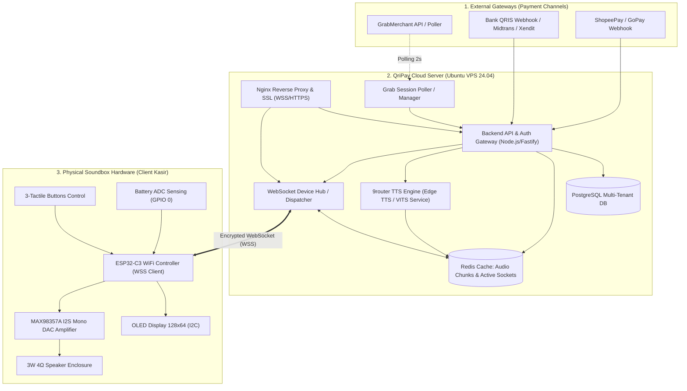
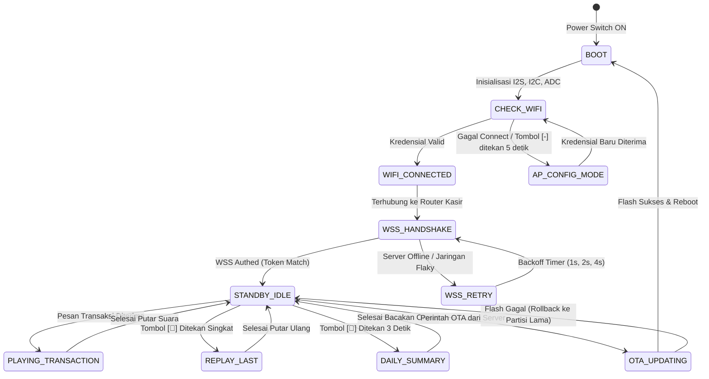

# SPESIFIKASI ARSITEKTUR SISTEM
**End-to-End System Topology, Dataflow, and Multi-Tenant Isolation**
*Versi: 2.0 | Status: APPROVED | Pemilik: AI Agent 03 (System Architecture)*

---

## 1. Topologi Sistem End-to-End

Berikut arsitektur menyeluruh dari penerimaan pembayaran hingga bunyi di speaker fisik soundbox:



---

## 2. Alur Transaksi & Pipeline Suara (< 500ms)

1. **Event Capture (< 100ms):**
   - Transaksi QRIS terjadi di outlet kasir.
   - Sesi GrabMerchant / Webhook QRIS mendeteksi perubahan status transaksi menjadi `SUCCESS`.
   - Payload transaksi (`store_id`, `amount`, `order_id`, `timestamp`) diterima backend QriPay.
2. **Device Resolution & Tenant Mapping (< 20ms):**
   - Backend memetakan `store_id` (misal: `03555c6f...` untuk Pempek Silampari) ke `device_id` soundbox yang sedang aktif terhubung di Redis registry.
3. **TTS Synthesis & Chime Assembly (< 120ms):**
   - Frasa suara disusun: `"Pembayaran QRIS berhasil diterima, Rp [NOMINAL], [NAMA_TOKO]"`.
   - Backend mengecek Redis cache; jika audio sudah ada, langsung kirim. Jika belum, 9router TTS menghasilkan audio stream MP3/WAV 24kHz.
4. **WebSocket Push (< 30ms):**
   - WebSocket Hub mengirimkan frame binary audio ke soundbox yang dituju melalui koneksi TCP/WSS aktif.
5. **Hardware Decoding & Playback (< 150ms):**
   - ESP32-C3 memicu nada intro chime pendek (*Do-Mi-Sol* 80ms) dari SPIFFS lokal untuk menghilangkan jeda persepsi kasir.
   - Bersamaan dengan itu, buffer DMA I2S diisi oleh stream audio dari WebSocket dan diputar jernih melalui chip MAX98357A.
   - Layar OLED menampilkan animasi nominal: `+Rp 25.000` dan icon centang hijau.

---

## 3. Diagram State Machine Soundbox Firmware



---

## 4. Model Isolasi Multi-Tenant (*Tenant & Outlet Isolation*)

Untuk mendukung 10.000+ perangkat dalam 1 infrastruktur:
1. **Hirarki Data:**
   `Tenant (Pemilik Bisnis)` &rarr; `Merchants (Brand/Usaha)` &rarr; `Outlets (Cabang Toko)` &rarr; `Soundbox Devices (Hardware MAC/UUID)`.
2. **Channel Isolation di WebSocket:**
   Setiap soundbox berlangganan channel unik: `/channels/tenant_{tenant_id}/outlet_{outlet_id}/device_{device_id}`.
   Transaksi toko cabang A tidak akan pernah terkirim ke soundbox cabang B.
3. **Heartbeat & Telemetri Real-time:**
   Setiap 30 detik, soundbox mengirimkan paket ping telemetri:
   ```json
   {
     "device_id": "SB-C3-00129",
     "battery_pct": 87,
     "battery_mv": 3980,
     "rssi": -58,
     "fw_version": "v3.5.2",
     "uptime_sec": 14200
   }
   ```

---

## 5. Verifikasi & Alur Validasi Silang (*Sign-Off*)

- **Dibuat Oleh:** AI Agent 03 (System Architecture)
- **Reviewer 1 (Kesesuaian Backend & API):** AI Agent 08 (Backend Engineering) &rarr; `STATUS: APPROVED`
- **Reviewer 2 (Kesesuaian Skema Database):** AI Agent 07 (Database Engineering) &rarr; `STATUS: APPROVED`
- **Reviewer 3 (Kesesuaian Driver Firmware):** AI Agent 06 (Embedded Firmware) &rarr; `STATUS: APPROVED`
- **Reviewer 4 (Audit Keamanan Protokol):** AI Agent 10 (Information Security) &rarr; `STATUS: APPROVED`
