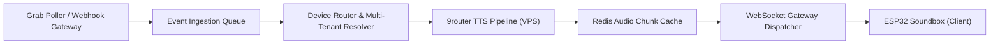

# BACKEND API & PIPELINE TTS 9ROUTER
**Microservices Architecture, Grab Poller, Ultra-Fast TTS Synthesis, and WebSocket Dispatcher**
*Versi: 2.0 | Status: APPROVED | Pemilik: AI Agent 08 (Backend Engineering)*

---

## 1. Arsitektur Layanan Backend (Node.js / Fastify)

Backend QriPay dirancang menggunakan framework **Fastify** untuk mencapai throughput tinggi (> 30.000 req/sec) dengan overhead latency minimal (< 5ms).



---

## 2. Pipeline Integrasi TTS 9router di VPS

Untuk mendukung suara dinamis dengan jeda minimal:
1. **Pre-Rendered Number Bank:**
   Nominal ribuan umum disimpan permanen dalam memori Redis VPS (`audio:num:10000`, `audio:num:25000`).
2. **Dynamic Store Name Synthesis (9router Engine):**
   Kalimat kustom atau salam toko di-request ke container 9router TTS lokal (menggunakan Edge TTS / Sherpa-ONNX VITS Engine) via socket internal `http://127.0.0.1:8080/synthesize`.
3. **Format Output:**
   - Format: `audio/mpeg` (MP3) Mono 24.000 Hz, 32 kbps (Sangat ringan, ukuran file hanya ~12KB per kalimat 3 detik).
   - Bitrate ini menghemat kuota WiFi merchant dan mengalirkan paket dalam < 30ms ke ESP32.

### Cuplikan Implementasi Pipeline Suara:
```javascript
// services/audioPipeline.js
const axios = require('axios');
const redis = require('../lib/redis');

async function getPaymentAudioBuffer(amount, outletName, voiceId = 'id-ID-ArdiNeural') {
  const cacheKey = `tts:${voiceId}:${amount}:${outletName}`;
  const cached = await redis.getBuffer(cacheKey);
  if (cached) return cached;

  const phrase = `Pembayaran QRIS berhasil diterima, Rp ${amount.toLocaleString('id-ID')}, ${outletName}`;
  
  // Panggil 9router TTS service lokal di VPS
  const response = await axios.post('http://127.0.0.1:8080/v1/audio/speech', {
    input: phrase,
    voice: voiceId,
    response_format: 'mp3',
    speed: 1.05
  }, { responseType: 'arraybuffer' });

  const audioBuffer = Buffer.from(response.data);
  // Cache selama 24 jam di Redis
  await redis.set(cacheKey, audioBuffer, 'EX', 86400);
  return audioBuffer;
}
```

---

## 3. WebSocket Gateway Dispatcher (WSS)

Koneksi soundbox dikelola secara persisten dengan autentikasi berbasis HMAC token unik:
- **Handshake Endpoint:** `wss://api.qripay.id/ws/v1/soundbox`
- **Headers Autentikasi:**
  - `X-Device-ID: SB-C3-00129`
  - `X-Device-Token: hmac_sha256(device_id + secret_key)`

### Protokol Pesan Kontrol WebSocket (JSON Control Frames):

#### A. Transaksi Pembayaran Masuk (Push ke Perangkat):
```json
{
  "event": "PAYMENT_NOTIFICATION",
  "transaction_id": "trx_981240182",
  "amount": 25000,
  "formatted_text": "Rp 25.000",
  "audio_stream_url": "https://api.qripay.id/stream/audio/trx_981240182.mp3",
  "oled_payload": {
    "title": "QRIS BERHASIL",
    "nominal": "Rp 25.000",
    "icon": "CHECK_OK"
  }
}
```

#### B. Permintaan Putar Ulang (*Replay Request* dari Tombol Box):
```json
// Dari ESP32 ke Server:
{ "event": "ACTION_REPLAY", "device_id": "SB-C3-00129" }

// Respon Server ke ESP32:
{
  "event": "AUDIO_REPLAY_RESPONSE",
  "audio_stream_url": "https://api.qripay.id/stream/audio/trx_981240182.mp3",
  "amount": 25000
}
```

#### C. Permintaan Rekap Omset Harian (*Daily Summary Request*):
```json
// Dari ESP32 ke Server (Saat tombol [🔁] ditekan 3 detik):
{ "event": "ACTION_GET_DAILY_SUMMARY", "device_id": "SB-C3-00129" }

// Respon Server:
{
  "event": "DAILY_SUMMARY_RESPONSE",
  "total_count": 48,
  "total_amount": 1450000,
  "audio_stream_url": "https://api.qripay.id/stream/audio/summary_today_00129.mp3",
  "speech_text": "Total omset hari ini satu juta empat ratus lima puluh ribu rupiah dari 48 transaksi."
}
```

---

## 4. Poller Sesi GrabMerchant Terisolasi (`grabSessionManager.js`)

Sesi Grab merchant dikelola otomatis di background:
- Menggunakan endpoint Grab POS API `https://api.grab.com/pos/v1/merchant/transactions`.
- Melakukan polling interval adaptif: 2 detik pada jam buka toko (08.00–22.00) dan 10 detik pada malam hari untuk efisiensi resource.
- Menyimpan status transaksi terakhir di memori; hanya transaksi dengan status baru `COMPLETED` yang memicu audio broadcast.

---

## 5. Verifikasi & Alur Validasi Silang (*Sign-Off*)

- **Dibuat Oleh:** AI Agent 08 (Backend Engineering)
- **Reviewer 1 (Kesesuaian Topologi):** AI Agent 03 (System Architecture) &rarr; `STATUS: APPROVED`
- **Reviewer 2 (Sinkronisasi Firmware I2S):** AI Agent 06 (Embedded Firmware) &rarr; `STATUS: APPROVED`
- **Reviewer 3 (Kesesuaian API Aplikasi Kasir):** AI Agent 09 (Mobile Engineering) &rarr; `STATUS: APPROVED`
- **Reviewer 4 (Audit Beban & Throughput):** AI Agent 11 (Quality Assurance) &rarr; `STATUS: APPROVED`
