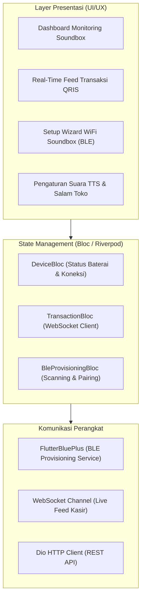

# SPESIFIKASI APLIKASI MOBILE COMPANION
**Mobile Architecture, BLE WiFi Provisioning, Real-Time Stream, and Soundbox Control**
*Versi: 2.0 | Status: APPROVED | Pemilik: AI Agent 09 (Mobile Engineering)*

---

## 1. Arsitektur Aplikasi Mobile (Flutter Multiplatform)

Aplikasi kasir & pemilik toko dibangun menggunakan **Flutter (Dart)** untuk mendukung Android dan iOS dengan satu basis kode (*single codebase*).



---

## 2. Alur Onboarding & WiFi Provisioning via Bluetooth BLE

Kasir atau teknisi tidak perlu memasukkan kabel atau membuka browser untuk menyambungkan soundbox ke WiFi toko:

1. **BLE Advertising:**
   - Saat tombol `[-]` di soundbox ditekan selama 5 detik, ESP32 menyalakan BLE server dengan nama broadcast `QriPay-Soundbox-XXXX`.
2. **Auto-Discovery:**
   - Aplikasi Flutter otomatis mendeteksi beacon BLE dalam jarak 5 meter.
3. **Kirim Kredensial WiFi Terenkripsi:**
   - Aplikasi mengirimkan nama SSID toko dan Password WiFi menggunakan karakteristik BLE berenkripsi AES-128:
   ```json
   {
     "ssid": "Warung_Pempek_2.4G",
     "password": "rahasia_kasir_123",
     "tenant_token": "usr_991823a01"
   }
   ```
4. **Verifikasi & Bunyi Sukses:**
   - Soundbox mencoba koneksi ke router WiFi toko.
   - Jika berhasil, soundbox langsung membunyikan suara: *"WiFi berhasil terhubung, soundbox siap menerima pembayaran!"* dan aplikasi beralih ke layar dashboard utama.

---

## 3. Fitur Utama Aplikasi Companion

### A. Live Soundbox Fleet Monitor
- Menampilkan seluruh perangkat soundbox milik merchant.
- Parameter real-time:
  - Indikator Status: `ONLINE (Hijau)` / `OFFLINE (Abu-abu)`.
  - Persentase Baterai: Nilai riil (misal: `88% - Normal`).
  - Kekuatan Sinyal WiFi: `RSSI -54 dBm (Sangat Baik)`.
  - Versi Firmware: `v3.5.0` (dengan tombol *Update OTA* jika tersedia versi baru).

### B. Mode Cadangan Bluetooth Kasir (Offline Fallback Bridge)
- Jika internet WiFi toko mati (*ISP IndiHome/Biznet gangguan*), aplikasi kasir di HP dapat beralih ke **Mode Hotspot/BLE Bridge**:
- Notifikasi pembayaran dari jaringan seluler 4G HP diteruskan secara lokal via Bluetooth BLE ke soundbox dalam waktu < 200ms, sehingga transaksi kasir tetap bersuara meski router toko mati.

### C. Kustomisasi Suara & Salam Penutup (Voice Studio)
- Memilih karakter suara:
  - **Ardi (Formal & Tegas):** Standar profesional perbankan.
  - **Ayu (Ramah & Hangat):** Cocok untuk cafe, restoran, dan boutique.
  - **Asep (Akrab):** Cocok untuk warung dan pasar kuliner.
- Mengubah teks salam promosi toko:
  - Input: *"Terima kasih sudah belanja di Soto Bangkong!"*
  - Tombol: *"Kirim ke Soundbox"* &rarr; Disimpan di cloud server untuk transaksi berikutnya.

---

## 4. Keamanan Aplikasi Mobile

- Menggunakan **Flutter Secure Storage** (Android Keystore / iOS Keychain) untuk menyimpan token JWT sesi merchant.
- Proteksi PIN / Biometrik (Fingerprint & FaceID) saat pemilik toko ingin mengubah rekening penarikan atau menghapus unit soundbox.

---

## 5. Verifikasi & Alur Validasi Silang (*Sign-Off*)

- **Dibuat Oleh:** AI Agent 09 (Mobile Engineering)
- **Reviewer 1 (Kesesuaian Desain & Layout):** AI Agent 04 (UI/UX Design) &rarr; `STATUS: APPROVED`
- **Reviewer 2 (Kesesuaian Protokol BLE):** AI Agent 06 (Embedded Firmware) &rarr; `STATUS: APPROVED`
- **Reviewer 3 (Kesesuaian Endpoint REST & WebSocket):** AI Agent 08 (Backend Engineering) &rarr; `STATUS: APPROVED`
