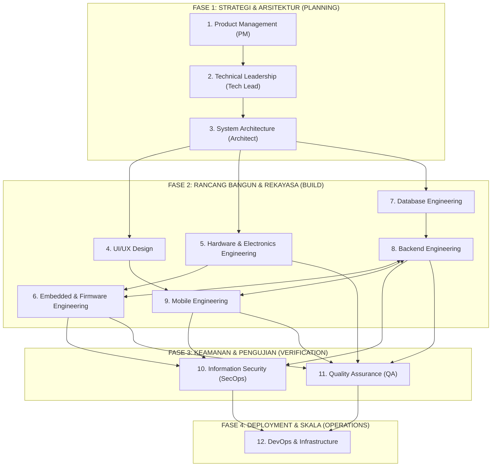

# MASTER PLAN: QRIPAY QRIS SOUNDBOX ENTERPRISE IoT (v5.0)
**Arsitektur Organisasi 12 AI Agent, Alur Kerja Kolaboratif, Validasi Silang, dan Roadmap Bisnis**

---

## 1. Visi & Tujuan Bisnis

Membangun ekosistem **QRIS IoT Soundbox Komersial Berbiaya Rendah namun Berkecepatan Tinggi (Ultra-Fast Response < 500ms)** untuk melayani ratusan hingga ribuan cabang merchant di seluruh Indonesia.

### Pilar Utama Keunggulan:
1. **Biaya Produksi Tertekan (< Rp 120.000 / unit):** Menggunakan ESP32 modern (S3/C3) + MAX98357A I2S digital DAC, mengeliminasi kebutuhan modul DFPlayer dan kartu MicroSD.
2. **Konektivitas Portabel Baterai:** Baterai 18650 3000mAh dengan booster 5.0V konstan dan sensor baterai real-time (tahan 18–24 jam pemakaian kasir).
3. **TTS Dinamis & Terpusat (9router di VPS):** Suara kasir digenerate di cloud dan di-stream secara instan via WebSocket, memungkinkan admin mengganti suara, aksen, dan kalimat promosi dari jarak jauh tanpa perlu menyentuh perangkat.
4. **Update Jarak Jauh (Over-The-Air / OTA):** Firmware sistem dapat diperbarui secara otomatis tanpa kabel.
5. **Multi-Cabang & Multi-Merchant Terisolasi:** Setiap kasir hanya membunyikan transaksi miliknya, bebas dari risiko suara ganda (*cross-talk*).

---

## 2. Struktur Kronologis 12 AI Agent (4 Fase Eksekusi)

Ke-12 AI Agent diurutkan secara logis ke dalam 4 fase proyek:



---

## 3. Matriks Relasi Antar-Agent & Alur Validasi Silang (*Peer-Review Loop*)

Setiap agen menghasilkan **file dokumentasi dan implementasi** di workspace folder `docs/`. File tersebut wajib **diverifikasi dan disetujui (sign-off)** oleh agen pemeriksa sebelum berlanjut ke tahap berikutnya:

| Urutan | Posisi AI Agent | Berkas Keluaran (*Deliverable File*) | Diverifikasi & Di-Check Oleh | Keterkaitan Relasi |
| :---: | :--- | :--- | :--- | :--- |
| **1** | **Product Management** | `docs/01_product_management/PRD_SOUNDBOX_ENTERPRISE.md` | **Tech Lead** & **UI/UX Design** | Menentukan kebutuhan pasar, model sewa/beli merchant, fitur 3 tombol kasir, dan SLA kecepatan suara (<500ms). |
| **2** | **Technical Leadership** | `docs/02_technical_leadership/TECH_STRATEGY_FEASIBILITY.md` | **System Architect** & **DevOps** | Menentukan keputusan chip (ESP32-S3 vs C3), protokol transmisi (WebSocket vs MQTT vs SSE), dan anggaran teknologi. |
| **3** | **System Architecture** | `docs/03_system_architecture/SYSTEM_ARCHITECTURE_SPEC.md` | **Backend**, **Database**, & **Firmware** | Merancang topologi end-to-end: Alur transaksi Grab/QRIS &rarr; VPS Node.js &rarr; 9router TTS Engine &rarr; ESP32 I2S DAC Audio. |
| **4** | **UI/UX Design** | `docs/04_ui_ux_design/DESIGN_SYSTEM_AND_EXPERIENCE.md` | **Product Management** & **Mobile Eng** | Merancang tata letak layar OLED 128x64, pola kedip LED status, nada chime Do-Mi-Sol, tombol fisik box, dan aplikasi kasir HP. |
| **5** | **Hardware & Electronics** | `docs/05_hardware_engineering/HARDWARE_SCHEMATICS_BOM.md` | **Firmware Eng** & **InfoSec** | Menyusun skematik kelistrikan baterai 18650, modul boost MH-CD42, kapasitor anti-brownout 470uF, DAC MAX98357A, dan casing Box X2. |
| **6** | **Embedded & Firmware** | `docs/06_embedded_firmware/FIRMWARE_ARCHITECTURE_ESP32.md` | **Hardware Eng** & **QA** | Menulis firmware C++/Arduino: Driver I2S DAC, WebSocket client, logic 3 tombol kasir, pembacaan ADC baterai, dan HTTP OTA updater. |
| **7** | **Database Engineering** | `docs/07_database_engineering/MULTI_TENANT_SCHEMA.md` | **Backend Eng** & **InfoSec** | Merancang skema database multi-tenant (Merchants, Outlets, Soundbox Devices, Transactions Queue, Audit Logs, OTA Versions). |
| **8** | **Backend Engineering** | `docs/08_backend_engineering/BACKEND_API_TTS_PIPELINE.md` | **System Architect** & **Mobile Eng** | Mengembangkan API Gateway, listener sesi GrabMerchant, pipeline TTS 9router, WebSocket broker, dan OTA binary server. |
| **9** | **Mobile Engineering** | `docs/09_mobile_engineering/COMPANION_APP_SPEC.md` | **UI/UX Design** & **Backend Eng** | Merancang aplikasi Android/Web kasir untuk setup WiFi awal soundbox (BLE/SmartConfig), rekap shift, dan notifikasi cadangan. |
| **10** | **Information Security** | `docs/10_information_security/SECURITY_AUDIT_COMPLIANCE.md` | **Tech Lead** & **DevOps** | Melakukan audit keamanan enkripsi token Grab, otentikasi mTLS/JWT perangkat soundbox, perlindungan anti-tamper, dan secure boot OTA. |
| **11** | **Quality Assurance** | `docs/11_quality_assurance/TEST_PLAN_QA_MATRIX.md` | **Hardware**, **Firmware**, & **Backend** | Menjalankan stres uji: Baterai 24 jam nonstop, 1.000 transaksi beruntun, simulasi WiFi lemah/packet loss, dan pengujian distorsi audio. |
| **12** | **DevOps & Infrastructure**| `docs/12_devops_infrastructure/DEVOPS_DEPLOYMENT_MONITORING.md`| **Tech Lead** & **InfoSec** | Konfigurasi server VPS Ubuntu, Docker container (Backend + 9router), CI/CD pipeline, monitoring Grafana/Prometheus (deteksi soundbox offline). |

---

## 4. Dua Tahapan Operasional Bisnis: Pra-Produksi vs Pasca-Produksi

Tugas ke-12 AI Agent beradaptasi secara otomatis sesuai dengan fase kesiapan produk:

```text
+------------------------------------------------------------------------------------------------+
| TAHAP 1: PRA-PRODUKSI / PLANNING (Sebelum Alat Fisik Jadi)                                      |
| Fokus: Riset, Desain, Skematik, Simulasi Wokwi, Pembuatan Prototipe, dan Pengujian Lab           |
+------------------------------------------------------------------------------------------------+
  • PM & Tech Lead       : Mengunci PRD, memilih ESP32-S3/C3, dan menghitung unit economics.
  • Hardware & Firmware  : Merakit 1 unit prototipe, menyolder komponen, menguji output I2S audio.
  • Backend & DB         : Membangun koneksi sesi Grab, pipeline TTS 9router, dan endpoint WebSocket.
  • QA & InfoSec         : Menguji latensi suara di Wokwi dan menganalisis celah keamanan token.
  • DevOps               : Menyiapkan VPS staging, Docker 9router TTS, dan domain API.

+------------------------------------------------------------------------------------------------+
| TAHAP 2: PASCA-PRODUKSI / OPERASIONAL & SKALA (Setelah Soundbox Fisik Jadi & Disebar ke Merchant)|
| Fokus: Produksi Massal, Onboarding Kasir, Pemeliharaan Armada (Fleet), dan Fitur Jarak Jauh    |
+------------------------------------------------------------------------------------------------+
  • PM & UI/UX           : Analisis retensi kasir, pengembangan fitur suara baru (branding promo toko).
  • Hardware & QA        : Quality Control (QC) perakitan massal sebelum soundbox dikirim ke merchant.
  • Firmware & Backend   : Push pembaruan firmware (OTA) massal dari server tanpa menarik unit fisik.
  • InfoSec & DevOps     : Monitoring uptime 24/7 armada soundbox se-Indonesia, rotasi token Grab berkala,
                           dan pencegahan serangan DoS ke gateway audio.
```

---

## 5. Struktur Standarisasi Berkas di Workspace (`docs/`)

Setiap dokumen disimpan dengan struktur folder terisolasi:

```text
docs/
├── MASTER_PLAN.md
├── 01_product_management/
│   └── PRD_SOUNDBOX_ENTERPRISE.md
├── 02_technical_leadership/
│   └── TECH_STRATEGY_FEASIBILITY.md
├── 03_system_architecture/
│   └── SYSTEM_ARCHITECTURE_SPEC.md
├── 04_ui_ux_design/
│   └── DESIGN_SYSTEM_AND_EXPERIENCE.md
├── 05_hardware_engineering/
│   └── HARDWARE_SCHEMATICS_BOM.md
├── 06_embedded_firmware/
│   └── FIRMWARE_ARCHITECTURE_ESP32.md
├── 07_database_engineering/
│   └── MULTI_TENANT_SCHEMA.md
├── 08_backend_engineering/
│   └── BACKEND_API_TTS_PIPELINE.md
├── 09_mobile_engineering/
│   └── COMPANION_APP_SPEC.md
├── 10_information_security/
│   └── SECURITY_AUDIT_COMPLIANCE.md
├── 11_quality_assurance/
│   └── TEST_PLAN_QA_MATRIX.md
└── 12_devops_infrastructure/
    └── DEVOPS_DEPLOYMENT_MONITORING.md
```

---

## 6. Roadmap Implementasi 4 Milestone

### 🎯 Milestone 1: Fondasi & Blueprint (Hari 1–3)
* Finalisasi spesifikasi PRD, arsitektur sistem, dan skema database.
* Sign-off persetujuan antar agen (PM &rarr; Tech Lead &rarr; Architect).

### 🎯 Milestone 2: Prototipe Hardware & Pipeline Audio VPS (Hari 4–8)
* Perakitan hardware fisik ESP32-C3/S3 + MAX98357A + Baterai 18650.
* Integrasi 9router TTS di VPS dengan latensi streaming di bawah 500ms.
* Uji coba pemutaran audio digital I2S langsung dari WebSocket.

### 🎯 Milestone 3: Fitur 3 Tombol, Sensor Baterai & Uji Stres (Hari 9–14)
* Implementasi logika 3 tombol: Volume (+/-), Putar Ulang (*Replay*), dan Rekap Harian.
* Pengujian sensor baterai ADC real-time di layar OLED.
* Audit keamanan token Grab dan penetrasi celah API oleh InfoSec.

### 🎯 Milestone 4: Produksi Pilot & Peluncuran Kasir Nyata (Hari 15+)
* Pemasangan soundbox di 4 cabang (Pusat, Pempek, Batagor, Soto).
* Uji coba transaksi riil di meja kasir dengan pembeli nyata.
* Monitoring armada perangkat melalui dashboard monitoring DevOps.
